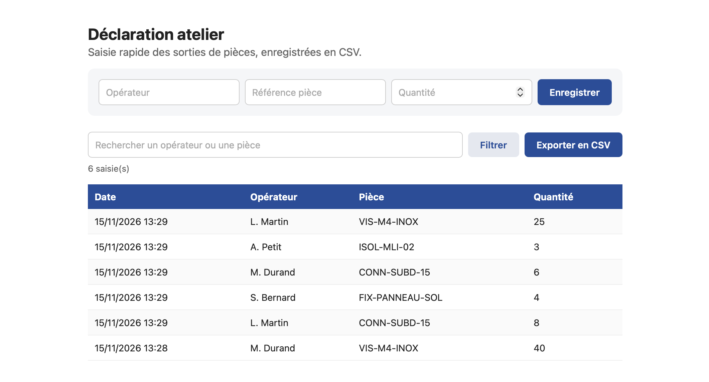

# Captation de données atelier (Flask)

Mini-outil web pour déclarer les sorties de pièces en atelier, pensé pour des utilisateurs non informaticiens.



## Fonctionnalités
- **Saisie** rapide via un formulaire (opérateur, référence pièce, quantité), enregistrée en CSV
- **Recherche / filtre** par opérateur ou par pièce
- **Export CSV** compatible Excel (et réutilisable dans un outil d'analyse type Dataiku)
- **API JSON** : `GET /api/saisies?q=...`
- **Rapport automatique** : `rapport.py` interroge l'API en HTTP et génère un récapitulatif (totaux par pièce et par opérateur) ; `rapport.bat` l'automatise et archive les rapports sous Windows

**Stack :** Python · Flask · Jinja2 · HTML/CSS · API REST · Batch

## Lancer le projet
```bash
pip install -r requirements.txt
python3 app.py          # puis ouvrir http://127.0.0.1:5000
python3 rapport.py      # dans un autre terminal, génère le rapport
```